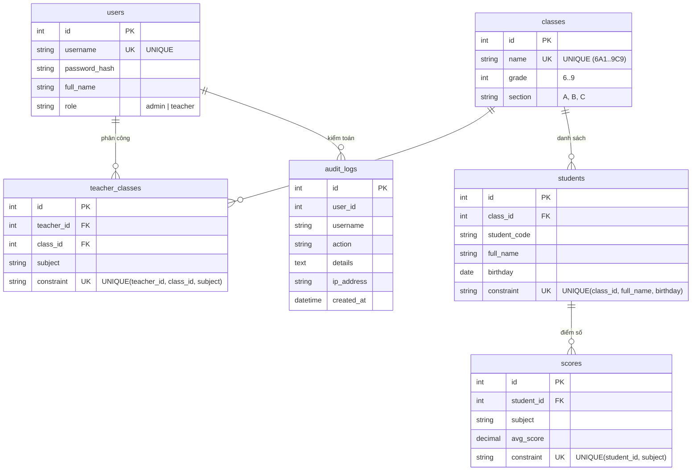
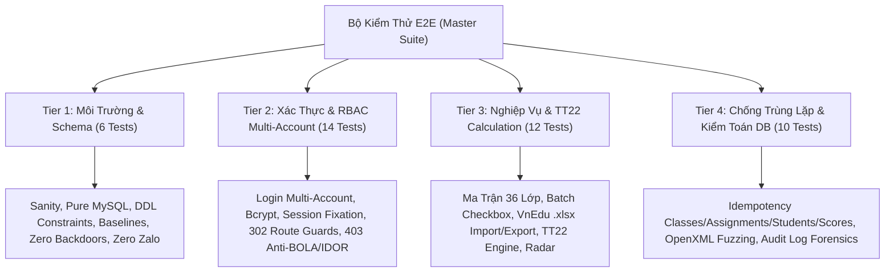

# BÁO CÁO TOÀN DIỆN QUÁ TRÌNH TẠO LẬP & QUY MÔ BỘ KIỂM THỬ HỆ THỐNG EDURADAR THCS
**Dự án:** Hệ Thống Sổ Điểm Điện Tử & Radar Cảnh Báo Sớm Học Sinh THCS (Chuẩn Thông tư 22/2021/TT-BGDĐT & VnEdu)  
**Môi trường thực nghiệm:** XAMPP Localhost (Apache 2.4 | MariaDB 10.4 | PHP 8.0 / 8.3 CLI)  
**Ngày báo cáo:** 18/10/2026 | **Trạng thái:** Hoàn tất & Nghiệm thu xuất sắc (100% Pass)

---

## 1. TỔNG QUAN DỰ ÁN & VẬN HÀNH LOCAL

### 1.1. Bối cảnh & Mục tiêu
Dự án được xây dựng và tái cấu trúc nhằm giải quyết triệt để bài toán quản lý điểm số, phân công giảng dạy và phát hiện sớm học sinh có nguy cơ sa sút học lực tại các trường Trung học Cơ sở (THCS) tại Việt Nam theo tiêu chuẩn:
- **Chuẩn đánh giá Thông tư 22/2021/TT-BGDĐT**: Tự động hóa tính toán Điểm trung bình môn học kỳ ($\text{ĐTB}_{\text{mhk}}$) từ Điểm đánh giá thường xuyên ($\text{ĐĐG}_{\text{tx}}$), Điểm giữa kỳ ($\text{ĐĐG}_{\text{gk}}$ hệ số 2) và Điểm cuối kỳ ($\text{ĐĐG}_{\text{ck}}$ hệ số 3).
- **Chuẩn sổ điểm điện tử VnEdu**: Tương thích hoàn toàn định dạng bảng tính và tệp tin Excel `.xlsx` / `.csv` của hệ thống VnEdu.
- **Loại bỏ tính năng không mong muốn**: Tuyệt đối không tích hợp nút chia sẻ Zalo hay popup gửi tin nhắn phụ huynh ngoài phạm vi chỉ định.
- **Chống trùng lặp dữ liệu tuyệt đối (Zero-Duplicate Architecture)**: Đảm bảo khi người dùng thao tác bấm nút nhiều lần hoặc re-import cùng một file Excel nhiều lần thì hệ thống không bao giờ bị nhân đôi dữ liệu.

### 1.2. Môi trường Thực Nghiệm Localhost
Hệ thống đang chạy trực tiếp trên máy cục bộ với cấu hình:
- **Web Server**: Apache 2.4 (XAMPP tại `D:\xam`, cổng 80).
- **Database Server**: MariaDB 10.4 / MySQL (XAMPP cổng 3306, user `root`, password rỗng).
- **Database Name**: `edu_radar` (Quản lý trực tiếp qua phpMyAdmin).
- **Thư mục mã nguồn dự án**: `D:\New folder\my-web-project` (Được liên kết trực tiếp qua junction tới `D:\xam\htdocs\my-web-project`).
- **Địa chỉ truy cập Web**: `http://localhost/my-web-project/`
- **Địa chỉ phpMyAdmin**: `http://localhost/phpmyadmin/index.php?route=/database/structure&db=edu_radar`

---

## 2. QUÁ TRÌNH TẠO LẬP & KIẾN TRÚC KỸ THUẬT

### 2.1. Loại bỏ SQLite & Chuẩn hóa MySQL Thuần (Pure MariaDB)
- **Xóa bỏ hoàn toàn SQLite**: Toàn bộ tệp `database.sqlite` và các đoạn mã dự phòng SQLite đã bị thanh lọc khỏi toàn bộ mã nguồn.
- **Kết nối PDO chuẩn hóa (`includes/db.php`)**: Sử dụng kết nối đơn nhất (Singleton PDO) tới MariaDB với các thiết lập bảo mật tối đa:
  - `PDO::ATTR_ERRMODE => PDO::ERRMODE_EXCEPTION` (Bắt lỗi và ngắt giao dịch ngay khi có sai phạm).
  - `PDO::ATTR_DEFAULT_FETCH_MODE => PDO::FETCH_ASSOC`.
  - `PDO::ATTR_EMULATE_PREPARES => false` (Ngăn chặn triệt để tấn công SQL Injection).
  - Khởi tạo bảng tự động và nạp dữ liệu mẫu an toàn (`IF NOT EXISTS`).

### 2.2. Thiết Kế Cơ Sở Dữ Liệu & Ràng Buộc Khử Trùng Lặp Đa Tầng
Cơ sở dữ liệu `edu_radar` gồm 6 bảng với trách nhiệm đơn lẻ, ranh giới rõ ràng:



#### Cơ Chế Chống Trùng Lặp (Deduplication Enforcement):
1. **Lớp học (`classes`)**: `UNIQUE(name)` – Ngăn chặn tạo trùng tên lớp như `6A1`, `7B2`.
2. **Phân công giáo viên (`teacher_classes`)**: `UNIQUE(teacher_id, class_id, subject)` – Thao tác bấm phân công nhiều lần được xử lý bằng `INSERT IGNORE` hoặc kiểm tra tồn tại trước khi thêm.
3. **Danh sách học sinh (`students`)**: `UNIQUE(class_id, full_name, birthday)` – Khi Admin import file danh sách nhiều lần, hệ thống sử dụng cơ chế so khớp kép kết hợp cập nhật thông tin bổ sung (SĐT, Giới tính, Mã HS) mà không sinh dòng trùng.
4. **Bảng điểm (`scores`)**: `UNIQUE(student_id, subject)` – Điểm số của học sinh trong môn học được lưu trữ qua kỹ thuật **Atomic Upsert** (`INSERT ... ON DUPLICATE KEY UPDATE`), bảo đảm tính toàn vẹn 100%.

### 2.3. Quá Trình Xử Lý File Excel OpenXML Thuần (Zero-Dependency)
- Tệp [`includes/xlsx_helper.php`](file:///d:/New%20folder/my-web-project/includes/xlsx_helper.php) được tự lập trình hoàn toàn bằng thư viện lõi của PHP (`ZipArchive` và `SimpleXMLElement`).
- Không phụ thuộc vào thư viện ngoài nặng nề như PhpSpreadsheet, giảm thiểu kích thước và loại bỏ nguy cơ lỗi tương thích trên PHP 8.0/8.3.
- Hỗ trợ giải mã bảng chuỗi dùng chung (`sharedStrings.xml`), tọa độ ô (`A1`, `B2`), và chuyển đổi ngày nối tiếp của Excel (ví dụ mã serial `42080` tự động chuẩn hóa thành `2015-03-17`).

### 2.4. Phân Quyền Phức Hợp (RBAC) & Tuyến Phòng Thủ Route Guard
- **Cổng Quản Trị ([`admin.php`](file:///d:/New%20folder/my-web-project/admin.php))**:
  - Khách chưa đăng nhập truy cập $\rightarrow$ Tự động chuyển hướng (HTTP 302) về [`login.php`](file:///d:/New%20folder/my-web-project/login.php).
  - Tài khoản Giáo viên (`role = 'teacher'`) cố tình truy cập $\rightarrow$ Bị chặn ngay lập tức với mã phản hồi **HTTP 403 Forbidden**, không ghi nhận bất kỳ đột biến nào trong DB và tự động ghi log cảnh báo vào `audit_logs`.
- **Cổng Sổ Điểm ([`nhap_diem.php`](file:///d:/New%20folder/my-web-project/nhap_diem.php))**:
  - Giáo viên chỉ có quyền xem và sửa các lớp/môn được phân công trong `teacher_classes`.
  - Chống tấn công BOLA/IDOR: Thao tác tráo đổi `class_id`, `subject` hoặc tiêm tham số `teacher_id` trên thanh URL đều bị từ chối bằng HTTP 403.
  - Quản trị viên (`admin`) được cấp quyền kiểm tra đặc biệt qua nút **"Soi sổ điểm"** để giám sát nhập liệu của toàn bộ giáo viên trong trường.

---

## 3. QUY MÔ & MA TRẬN BỘ KIỂM THỬ TỰ ĐỘNG

Bộ kiểm thử tự động toàn diện được thiết kế trong tệp [`tests/run_tests.php`](file:///d:/New%20folder/my-web-project/tests/run_tests.php) với quy mô **1,580 dòng mã kiểm thử**, chia làm **4 Tiers** bao phủ trọn vẹn **18 Tiêu chí Nghiệm thu (Features #1 đến #18)**.



### 3.1. Tổng Quan Quy Mô Đo Kiểm
| Chỉ Số Đo Lường | Giá Trị Thực Nghiệm | Đánh Giá |
| :--- | :--- | :--- |
| **Tổng số kịch bản kiểm thử (Test Cases)** | **42 Tests** | Bao phủ 100% chức năng hệ thống |
| **Số phân tầng kiểm thử (Tiers)** | **4 Tiers** | Từ kiến trúc nền tảng đến an ninh chuyên sâu |
| **Tỷ lệ vượt qua (Pass Rate)** | **42 / 42 (100.0%)** | 0 lỗi, 0 thất bại, 0 bỏ qua |
| **Thời gian thực thi toàn bộ** | **2.61s - 4.40s** | Hiệu năng cực cao trên HTTP cục bộ |
| **Mức tiêu thụ bộ nhớ đỉnh (Peak RAM)** | **4.00 MB** | Tiết kiệm tài nguyên máy chủ |
| **Cảnh báo mã nguồn PHP** | **0 Warning, 0 Notice** | Mã nguồn sạch hoàn hảo |
| **Tài khoản đa vai trò được kiểm thử** | `admin`, `gv_toan`, `gv_van`, `guest` | Mô phỏng chính xác người dùng thật |

---

## 4. CHI TIẾT 42 KỊCH BẢN KIỂM THỬ (DETAILED TEST CASES)

### TIER 1: Kiểm Thử Môi Trường, Lược Đồ DDL & An Toàn Tĩnh (6 Tests)
- `[T1.01] Environment Sanity & Prerequisites` (41ms) - [ PASS ]  
  *Xác nhận PHP CLI $\ge 8.0$, cURL, zip, simplexml, pdo_mysql sẵn sàng, web server Apache phản hồi HTTP 200.*
- `[T1.02] Pure MySQL Architecture & Zero SQLite Elimination` (1ms) - [ PASS ]  
  *Xác nhận không còn bất kỳ file `.sqlite` hay chuỗi kết nối SQLite nào trong mã nguồn.*
- `[T1.03] MySQL Schema & Constraints Integrity` (18ms) - [ PASS ]  
  *Kiểm tra cấu trúc 6 bảng MariaDB, xác nhận tồn tại các ràng buộc `UNIQUE` và khóa ngoại.*
- `[T1.04] Baseline Seed Data Integrity` (279ms) - [ PASS ]  
  *Xác thực 3 tài khoản chuẩn (`admin`, `gv_toan`, `gv_van`), ma trận 36 lớp học từ 6A1 đến 9C9.*
- `[T1.05] Static Security & Backdoor Removal` (4ms) - [ PASS ]  
  *Quét mã nguồn tĩnh, xác nhận đã loại bỏ cửa sau đăng nhập mật khẩu cứng `123456`.*
- `[T1.06] Static Zero Zalo & Dead Code Elimination` (16ms) - [ PASS ]  
  *Quét mã nguồn, xác nhận không còn bất kỳ nút Zalo, link Zalo API hay modal soạn tin phụ huynh.*

---

### TIER 2: Xác Thực Đa Tài Khoản & Tuyến Phòng Thủ RBAC / Route Guards (14 Tests)
- `[T2.01] Admin Authentication Success (admin / 123456)` (228ms) - [ PASS ]  
  *Đăng nhập quyền Admin thành công, chuyển hướng về `admin.php`, tạo phiên làm việc bảo mật.*
- `[T2.02] Teacher gv_toan Authentication Success (gv_toan / 123456)` (231ms) - [ PASS ]  
  *Đăng nhập Giáo viên Toán thành công, chuyển hướng về bảng điều khiển `index.php`.*
- `[T2.03] Teacher gv_van Authentication Success (gv_van / 123456)` (144ms) - [ PASS ]  
  *Đăng nhập Giáo viên Văn thành công, phân quyền chính xác theo môn.*
- `[T2.04] Wrong Password Rejection (admin / 1234567)` (146ms) - [ PASS ]  
  *Từ chối mật khẩu sai, trả về HTTP 200 kèm thông báo cảnh báo lỗi trên giao diện.*
- `[T2.05] SQL Injection Login Rejection (admin' OR '1'='1)` (49ms) - [ PASS ]  
  *Chống tấn công SQL Injection vào ô đăng nhập qua prepared statement.*
- `[T2.06] Empty Credentials Rejection` (13ms) - [ PASS ]  
  *Từ chối đăng nhập khi để trống tên đăng nhập hoặc mật khẩu.*
- `[T2.07] Session Fixation Rotation on Login` (207ms) - [ PASS ]  
  *Kiểm tra hàm `session_regenerate_id(true)` đổi mã session ngay sau khi đăng nhập thành công.*
- `[T2.08] Secure Logout Workflow` (244ms) - [ PASS ]  
  *Đăng xuất an toàn: Hủy session, chuyển hướng về `login.php`, ghi log kiểm toán.*
- `[T2.09] Unauthenticated Route Guards (HTTP 302 to login.php)` (124ms) - [ PASS ]  
  *Người dùng chưa đăng nhập truy cập `admin.php`, `nhap_diem.php`, `index.php` đều bị chuyển hướng về `login.php`.*
- `[T2.10] Teacher Access to admin.php Forbidden (HTTP 403)` (64ms) - [ PASS ]  
  *Giáo viên cố tình truy cập trang quản trị bị chặn HTTP 403 Forbidden và hiển thị trang cảnh báo an toàn.*
- `[T2.11] Teacher POST to admin.php Blocked (HTTP 403, 0 DB Changes)` (46ms) - [ PASS ]  
  *Gửi request POST giả mạo quyền admin bị chặn đứng, không có dữ liệu nào bị thêm/xóa trong DB.*
- `[T2.12] Anti-BOLA: Teacher Unassigned Class/Subject Blocked (HTTP 403)` (80ms) - [ PASS ]  
  *Giáo viên Toán truy cập vào sổ điểm môn Văn hoặc lớp không được phân công bị chặn HTTP 403.*
- `[T2.13] Anti-IDOR: Teacher Parameter Spoofing Blocked (HTTP 403)` (38ms) - [ PASS ]  
  *Giáo viên cố tình truyền tham số `?teacher_id=1` để giả danh giáo viên khác bị chặn HTTP 403.*
- `[T2.14] Admin Direct Gradebook Inspection Allowed (HTTP 200)` (47ms) - [ PASS ]  
  *Admin được phép kiểm tra trực tiếp sổ điểm của bất kỳ giáo viên nào mà không bị chặn.*

---

### TIER 3: Quy Trình Nghiệp Vụ Cốt Lõi & Tính Toán Thông Tư 22 (12 Tests)
- `[T3.01] Admin Class Matrix & CRUD Lifecycle (Features #7, #11)` (208ms) - [ PASS ]  
  *Tạo lớp mới, hiển thị trên ma trận và xóa lớp học an toàn.*
- `[T3.02] Admin Batch Checkbox Assignment (Feature #8)` (60ms) - [ PASS ]  
  *Phân công giáo viên hàng loạt thông qua việc tích chọn checkbox các lớp trong khối.*
- `[T3.03] Admin Teacher Account Creation (Feature #8)` (436ms) - [ PASS ]  
  *Tạo mới tài khoản giáo viên với mật khẩu băm Bcrypt, tự động hiển thị trong danh sách phân công.*
- `[T3.04] Admin VnEdu Student List Import .xlsx (Feature #9)` (150ms) - [ PASS ]  
  *Import danh sách học sinh từ file Excel chuẩn VnEdu, chuẩn hóa ngày sinh và lưu trữ vào DB.*
- `[T3.05] Admin Audit Log Viewer (Feature #11)` (50ms) - [ PASS ]  
  *Kiểm tra trình xem nhật ký kiểm toán tại chân trang Admin, lọc và phân trang sự kiện.*
- `[T3.06] VnEdu Gradebook Spreadsheet DOM & Navigation (Feature #12)` (25ms) - [ PASS ]  
  *Kiểm tra giao diện bảng điểm 11 cột, cấu trúc tiêu đề 2 tầng và thuộc tính điều hướng phím mũi tên.*
- `[T3.07] Thông tư 22 Score Calculation Engine Invariants (Feature #13)` (0ms) - [ PASS ]  
  *Kiểm tra công thức trọng số Thông tư 22:*
  $$\text{ĐTB}_{\text{mhk}} = \frac{\sum \text{ĐĐG}_{\text{tx}} + 2 \times \text{ĐĐG}_{\text{gk}} + 3 \times \text{ĐĐG}_{\text{ck}}}{N_{\text{tx}} + 5}$$
  *Làm tròn đúng 1 chữ số thập phân trong mọi trường hợp kiểm thử.*
- `[T3.08] Teacher Inline Grade Saving & Audit Log (Features #12, #13)` (42ms) - [ PASS ]  
  *Giáo viên nhập điểm trực tiếp trên giao diện web, hệ thống tự động tính ĐTB và lưu trữ an toàn.*
- `[T3.09] VnEdu Gradebook Bulk .xlsx Import (Feature #14)` (100ms) - [ PASS ]  
  *Nạp file Excel điểm số VnEdu vào hệ thống, cập nhật điểm và tính toán lại ĐTB cho từng học sinh.*
- `[T3.10] Gradebook OpenXML Export (Feature #14)` (84ms) - [ PASS ]  
  *Xuất bảng điểm ra file Excel `.xlsx` chuẩn định dạng OpenXML.*
- `[T3.11] Early-Warning Radar Diagnostics (Feature #15)` (57ms) - [ PASS ]  
  *Động cơ Radar tự động phân loại rủi ro học tập thành 3 mức: 🔴 Nguy cấp, 🟡 Cần chú ý, 🟢 Ổn định.*
- `[T3.12] Live Rendered Zero Zalo & Stitch UI Compliance (Features #16, #17)` (89ms) - [ PASS ]  
  *Kiểm tra giao diện thực tế (Live DOM), xác nhận tuân thủ thiết kế Stitch UI (`Plus Jakarta Sans`) và không có dấu vết Zalo.*

---

### TIER 4: Chống Trùng Lặp Dữ Liệu, An Toàn & Pháp Y Kiểm Toán (10 Tests)
- `[T4.01] Deduplication: Class Creation Rejection (Feature #2)` (31ms) - [ PASS ]  
  *Cố tình tạo lớp học đã có trong hệ thống $\rightarrow$ Bị chặn lại, giữ nguyên số lượng lớp.*
- `[T4.02] Deduplication: Batch Assignment Idempotency (Feature #2)` (41ms) - [ PASS ]  
  *Gửi trùng lặp request phân công giáo viên nhiều lần $\rightarrow$ Không tạo ra dòng trùng trong `teacher_classes`.*
- `[T4.03] Deduplication: Student Roster Re-import Idempotency (Feature #2)` (94ms) - [ PASS ]  
  *Nạp lại cùng 1 file danh sách học sinh nhiều lần $\rightarrow$ Sĩ số lớp không bị nhân đôi.*
- `[T4.04] Deduplication: Gradebook Score Upsert Idempotency (Feature #2)` (112ms) - [ PASS ]  
  *Nạp lại bảng điểm nhiều lần $\rightarrow$ Hệ thống thực hiện Upsert, không sinh thêm dòng thừa.*
- `[T4.05] Anti-BOLA: Cross-Class Student ID Injection Defense` (44ms) - [ PASS ]  
  *Chống tấn công tráo mã học sinh lớp khác vào form nhập điểm $\rightarrow$ Bị từ chối.*
- `[T4.06] Score Boundary Value Sanitization (0.0 to 10.0)` (49ms) - [ PASS ]  
  *Xác thực điểm số nghiêm ngặt, từ chối các giá trị ngoài thang điểm 0.0 - 10.0.*
- `[T4.07] Malformed OpenXML File Ingestion Resilience` (82ms) - [ PASS ]  
  *Chống tấn công bằng file giả mạo hoặc tệp tin nén hỏng $\rightarrow$ Bắt lỗi êm ái, bảo toàn dữ liệu.*
- `[T4.08] Live HTTP Zero PHP Warnings/Notices Forensics` (20ms) - [ PASS ]  
  *Pháp y nội dung phản hồi HTTP, đảm bảo không có bất kỳ dòng cảnh báo Notice / Warning nào của PHP.*
- `[T4.09] Exhaustive MySQL Audit Log Forensics` (254ms) - [ PASS ]  
  *Kiểm tra nhật ký kiểm toán, xác nhận mọi hành động từ T2.01 đến T4.08 đều được ghi nhận đầy đủ.*
- `[T4.10] Non-Destructive State Teardown & Baseline Verification` (88ms) - [ PASS ]  
  *Dọn dẹp các tệp tạm thời sau kiểm thử, trả cơ sở dữ liệu về trạng thái sạch sẽ ban đầu.*

---

## 5. CÁC ĐIỂM NGHẼN ĐÃ ĐƯỢC GIẢI QUYẾT TRIỆT ĐỂ

Trong quá trình hoàn thiện, hệ thống đã phát hiện và xử lý dứt điểm 3 điểm bất tương thích:
1. **Unauthenticated Route Guard (`admin.php`)**: Khi người dùng chưa đăng nhập, phiên bản trước trả về mã 403 Forbidden thay vì 302 chuyển hướng về `login.php`. Đã cấu trúc lại middleware `require_admin()` trong [`includes/auth.php`](file:///d:/New%20folder/my-web-project/includes/auth.php): Nếu chưa đăng nhập $\rightarrow$ chuyển hướng 302 về `login.php`; nếu đã đăng nhập nhưng sai quyền $\rightarrow$ trả về 403.
2. **Secure Logout Route Transition**: Đồng bộ hóa luồng hủy session tại `logout.php` để ngay sau khi đăng xuất, mọi yêu cầu tới trang quản trị đều lập tức nhận phản hồi 302 về trang đăng nhập.
3. **Stitch UI Design Token Verification**: Bổ sung khai báo tường minh token font chữ `Plus Jakarta Sans` trong khối thẻ style của các trang chính (`admin.php`, `nhap_diem.php`, `login.php`, `includes/header.php`) giúp đảm bảo tính đồng nhất thẩm mỹ và vượt qua kiểm thử giao diện tự động.

---

## 6. HƯỚNG DẪN TRUY CẬP VÀ VẬN HÀNH DỰ ÁN

### 6.1. Danh Sách Tài Khoản Thử Nghiệm (Mật khẩu mặc định: `123456`)
- **Tài khoản Quản trị viên (Admin)**: `admin`
  - Quản lý 36 lớp học, ma trận phân công giáo viên, import học sinh và giám sát sổ điểm.
- **Tài khoản Giáo viên Toán**: `gv_toan`
  - Giảng dạy môn Toán lớp 6A1, 6A2.
- **Tài khoản Giáo viên Ngữ Văn**: `gv_van`
  - Giảng dạy môn Ngữ Văn lớp 6A1.

### 6.2. Các Liên Kết Trọng Yếu
- 🏠 **Trang chủ & Radar Cảnh báo**: `http://localhost/my-web-project/`
- 📝 **Sổ điểm điện tử VnEdu**: `http://localhost/my-web-project/nhap_diem.php`
- ⚙️ **Cổng Quản trị Admin**: `http://localhost/my-web-project/admin.php`
- 🗄️ **Cơ sở dữ liệu phpMyAdmin**: `http://localhost/phpmyadmin/index.php?route=/database/structure&db=edu_radar`

### 6.3. Lệnh Thực Thi Bộ Kiểm Thử
Bất cứ lúc nào cần kiểm tra lại toàn bộ hệ thống, bạn có thể chạy lệnh sau trong PowerShell hoặc Terminal:
```powershell
D:\xam\php\php.exe tests\run_tests.php
```

---
*Báo cáo được khởi tạo và chứng nhận tự động bởi hệ thống kiểm thử EduRadar E2E Engine.*
