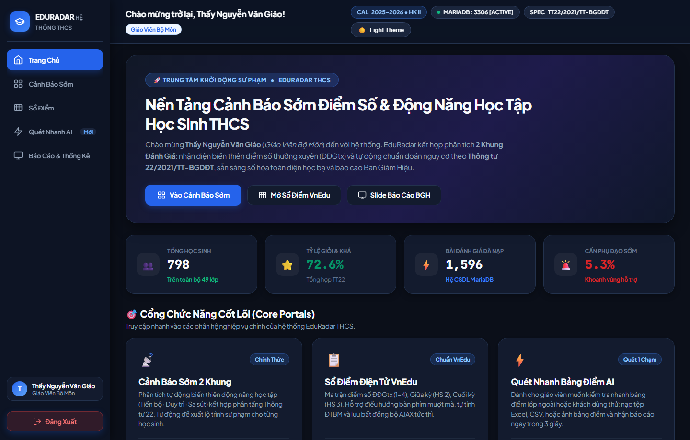
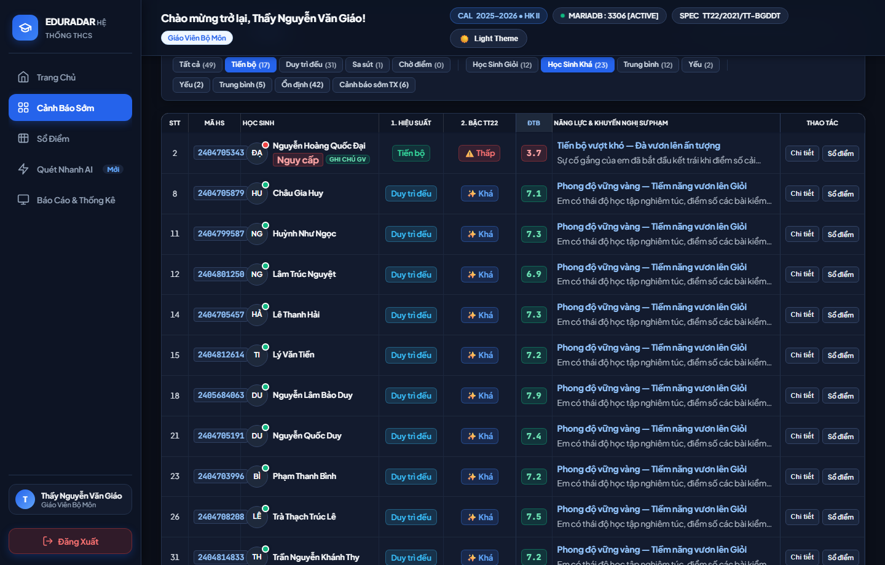
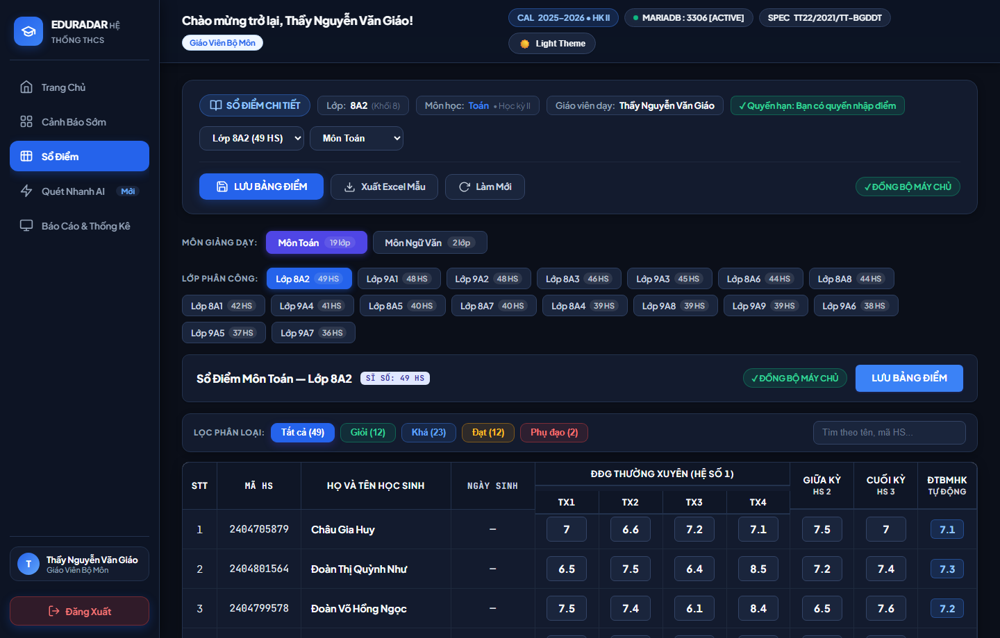
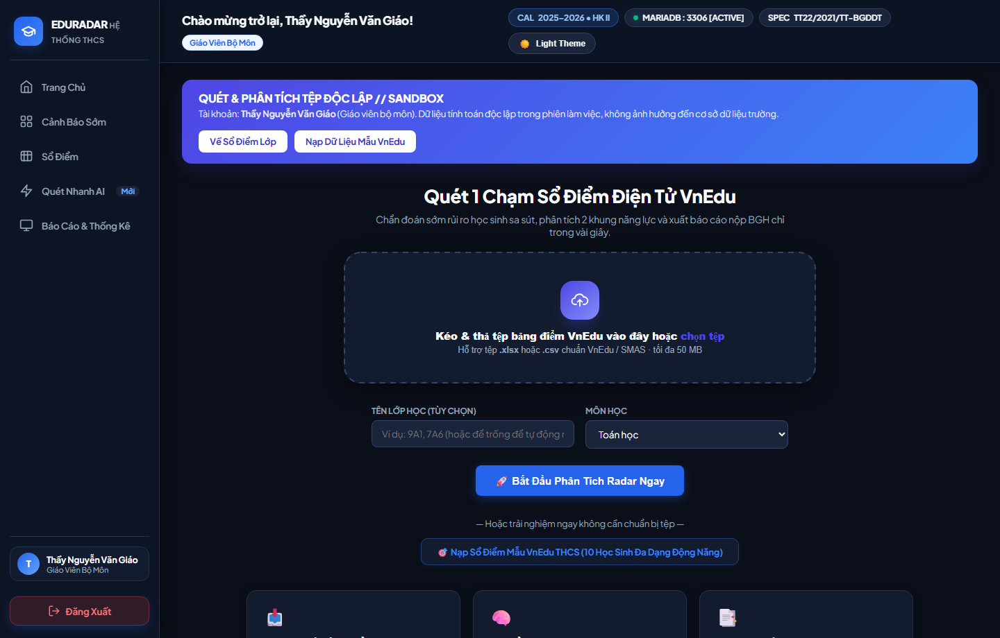
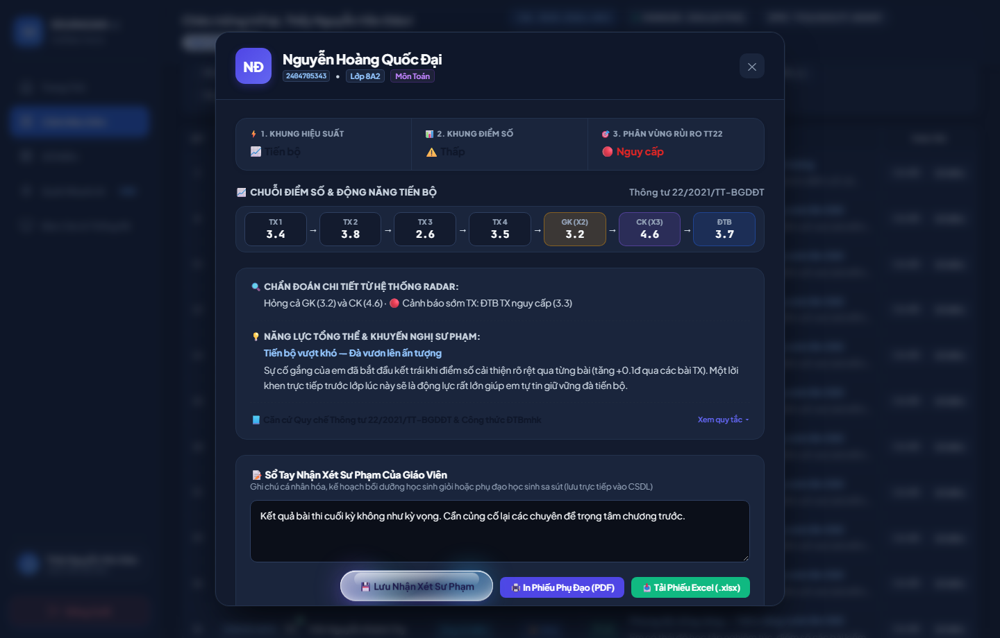
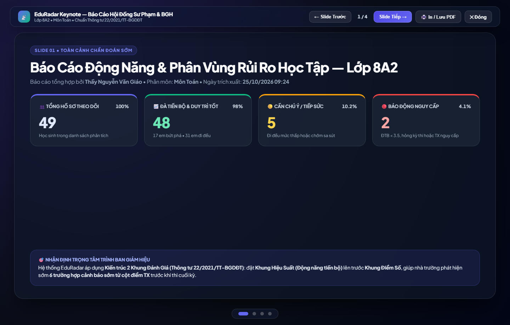

# 🏫 EduRadar THCS - Hệ Thống Cảnh Báo Sớm & Sổ Điểm Bộ Môn

> **Đồng hành cùng học sinh bứt phá năng lực học tập**  
> Hệ thống Radar 2 khung đánh giá tự động: phát hiện sớm nguy cơ sụt giảm điểm số theo **Thông tư 22/2021/TT-BGDĐT** và gợi ý lộ trình bồi dưỡng cá nhân hóa tức thì.

---

## 🌟 Tính Năng Nổi Bật

1. **Trang Chủ Bento Grid (Dribbble Style) & Hướng Dẫn 3 Bước:**
   - Thiết kế chuẩn sư phạm cao cấp, giao diện Bento trực quan.
   - Hướng dẫn 3 bước thao tác chuẩn cho Giáo viên bộ môn & Ban Giám Hiệu.
   - Tra cứu nhanh học sinh với định dạng Input Mask chuẩn UX.

2. **Radar Đánh Giá 2 Khung Độc Lập Chuẩn TT22:**
   - **Khung 1 - Hiệu Suất & Động Năng Học Tập (Momentum):** Đang Tiến Bộ / Bứt Phá, Đang Đi Đều / Duy Trì, Đang Sa Sút / Tuột Dốc.
   - **Khung 2 - Phân Khúc Điểm Số (Score Ranges):** Giỏi & Khá (≥ 6.5), Trung Bình (5.0 – 6.4), Yếu (< 5.0 hoặc điểm liệt).

3. **Bộ Lọc Đa Chọn (Multi-Select Filter Chips):**
   - Hỗ trợ chọn đồng thời nhiều phân loại (ví dụ: vừa xem học sinh *Sa sút*, vừa xem học sinh *Yếu*) với bộ lọc hợp (Union Filter) tức thì.

4. **Sổ Điểm Điện Tử vnEdu Live Sync:**
   - Nhập điểm ĐĐGtx (1-4), GK, CK với tính năng tự động tính toán ĐTB môn và xếp loại TT22 theo thời gian thực.
   - Đồng bộ dữ liệu đa chiều, khóa dữ liệu bảo mật theo phân công giảng dạy.

5. **Quét Nhanh AI & OCR Phiếu Điểm:**
   - Tải lên ảnh chụp danh sách điểm viết tay hoặc bảng in, AI nhận diện và điền tự động vào sổ điểm.

6. **Báo Cáo & Thống Kê Đa Định Dạng:**
   - Trình chiếu Slide Báo Cáo BGH trực tuyến với hiệu ứng chuyển trang mượt mà.
   - Xuất file PDF khổ A4 chuẩn in ấn và Excel (.xlsx) phục vụ lưu trữ học vụ.

7. **Giao Diện Dark Mode & Light Mode:**
   - Hỗ trợ cả 2 chế độ sáng và tối, độ tương phản dịu mắt, loại bỏ hoàn toàn viền chói gắt.

---

## 📸 Hình Ảnh Giao Diện Thực Tế

| Trang Chủ (Dark Mode) | Bảng Dữ Liệu Cảnh Báo Sớm (Dark Mode) |
|---|---|
|  |  |

| Sổ Điểm vnEdu (Dark Mode) | Quét Nhanh AI (Dark Mode) |
|---|---|
|  |  |

| Modal Chi Tiết Học Sinh (Dark) | Slide Báo Cáo BGH (Dark) |
|---|---|
|  |  |

---

## 🚀 Hướng Dẫn Cài Đặt & Chạy Cục Bộ

### 1. Yêu cầu hệ thống
- **PHP:** >= 8.0
- **MySQL / MariaDB:** >= 10.4
- **Web Server:** Apache (Khuyên dùng XAMPP)

### 2. Cài đặt mã nguồn
1. Sao chép thư mục dự án vào thư mục gốc của Web Server:
   - XAMPP Windows: D:\xam\htdocs\my-web-project hoặc C:\xampp\htdocs\my-web-project
2. Khởi động **Apache** và **MySQL** trên XAMPP Control Panel.

### 3. Cài đặt Cơ Sở Dữ Liệu
1. Mở phpMyAdmin: http://localhost/phpmyadmin
2. Tạo cơ sở dữ liệu mới với tên edu_radar (Collation: utf8mb4_unicode_ci).
3. Import tệp database/edu_radar_dump.sql vào cơ sở dữ liệu vừa tạo.

### 4. Đăng nhập hệ thống
Truy cập qua trình duyệt: http://localhost/my-web-project/index.php

**Tài khoản thử nghiệm:**
* **Giáo viên bộ môn:**
  - Tên đăng nhập: 
guyenvanan
  - Mật khẩu: 123456
* **Ban Giám Hiệu / Quản trị:**
  - Tên đăng nhập: dmin
  - Mật khẩu: 123456

---

## 🛡️ Bản Quyền & Giấy Phép
Phát triển cho khối Giáo Dục Trung Học Cơ Sở theo Thông tư 22/2021/TT-BGDĐT.
